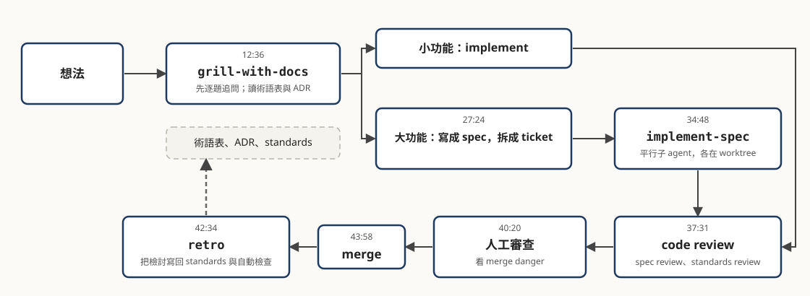
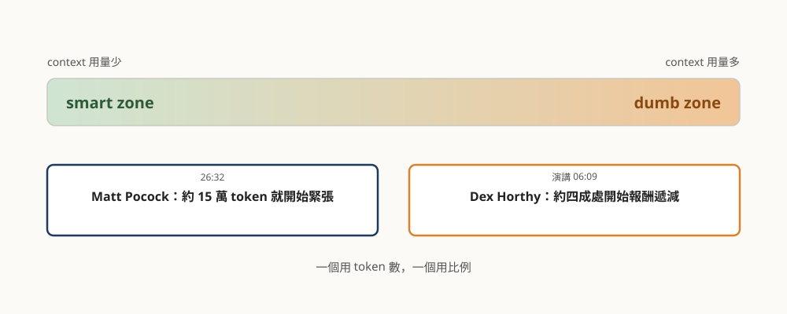
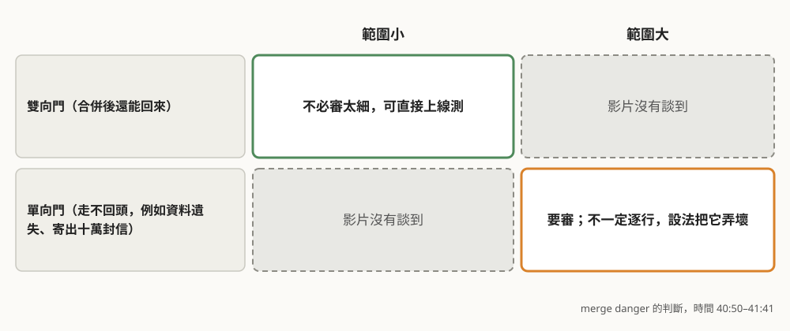
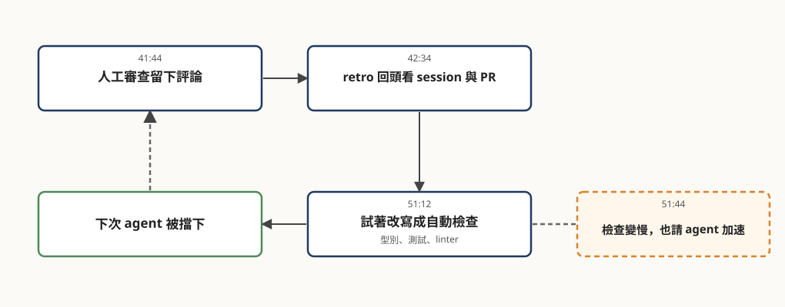
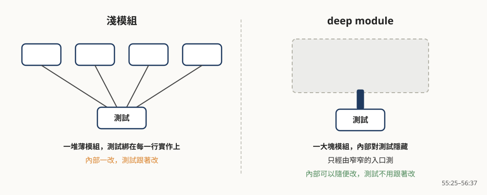

# Matt Pocock 談 AI 寫程式：戰術交給 agent，人要顧的是戰略這一層

> 本導讀的分析與撰稿由 AI 模型完成，不是人類分析，也沒有經過人工逐句校稿，見〈製作說明〉。

*圖說：AI 以程式繪製的示意插畫；圖內沒有文字，也不是影片畫面。*

主持人 NetworkChuck（下稱 Chuck）一開場就把全片的問題丟出來：現在還有人需要學特定的程式語言嗎？（[00:02](https://www.youtube.com/watch?v=mU8WKII1gpk&t=2s)）來賓 Matt Pocock 答「不用」，還說軟體工程一直比大家想的容易（[00:04](https://www.youtube.com/watch?v=mU8WKII1gpk&t=4s)）。接下來兩個小時，他把這句話拆成一套做法：**AI 擅長眼前的任務，長遠的結構要人來顧**；顧的方法，是把自己對好程式碼的看法寫進 agent 工作的環境，再靠自動檢查、人工審查與回顧一輪輪收緊。他整場一直回到同一個字：care，在意。

## 三十秒版

- Matt 借用 John Ousterhout 的區分：AI 擅長戰術性寫程式（眼前任務），戰略性（長期結構）他說「爛透了」，這一層要人來顧（[05:43](https://www.youtube.com/watch?v=mU8WKII1gpk&t=343s)）。
- 他的流程是 grill → spec 與 ticket → implement → code review → retro；開工前先讓 agent 逐題追問，並維護一份共用術語表（[44:18](https://www.youtube.com/watch?v=mU8WKII1gpk&t=2658s)）。
- 他用「smart zone」控制 context：超過約 15 萬 token 就開始緊張，所以大功能拆成 spec 和 ticket，每張約 15 萬 token（[27:24](https://www.youtube.com/watch?v=mU8WKII1gpk&t=1644s)、[36:51](https://www.youtube.com/watch?v=mU8WKII1gpk&t=2211s)）。
- 審 PR 看 merge danger：改動是單向門還是雙向門、出事的影響範圍多大，兩項都小就不細看（[40:50](https://www.youtube.com/watch?v=mU8WKII1gpk&t=2450s)）。
- 要信任 agent，靠自動檢查（型別、測試、linter），以及把程式碼整理成「deep modules」，讓測試從外面罩住一大塊（[49:24](https://www.youtube.com/watch?v=mU8WKII1gpk&t=2964s)、[56:00](https://www.youtube.com/watch?v=mU8WKII1gpk&t=3360s)）。
- 對新手，他建議讀經典書、做能展示的專案、證明你在意長期結構，不必指定程式語言（[1:35:15](https://www.youtube.com/watch?v=mU8WKII1gpk&t=5715s)、[1:36:27](https://www.youtube.com/watch?v=mU8WKII1gpk&t=5787s)）。

## 這篇怎麼讀

這是一場兩人對談，Chuck 提問，Matt 回答，影片由 Chuck 的頻道上傳。機器字幕沒有說話者標記，本文只在上下文明確時歸屬；「他」都指 Matt，Chuck 的話會寫明。影片有三段業配（ThreatLocker 約 [11:31](https://www.youtube.com/watch?v=mU8WKII1gpk&t=691s)、Coveron 約 [1:00:00](https://www.youtube.com/watch?v=mU8WKII1gpk&t=3600s)、Bitdefender 約 [1:18:25](https://www.youtube.com/watch?v=mU8WKII1gpk&t=4705s)）和結尾一段禱告，不屬於對談內容，本文不採用。

Matt 是 [mattpocock/skills](https://github.com/mattpocock/skills) 的作者，片中示範的就是自己的 skills，也在談自己的課程；他曾以約聘身分替 Vercel 工作（[1:15:32](https://www.youtube.com/watch?v=mU8WKII1gpk&t=4532s)），後面他推薦 Vercel 時要放在心上。片中數字多是他自述，本文以「他說」標示，有官方資料可核對的放在文末對照表。

*圖說：本文依 [12:36](https://www.youtube.com/watch?v=mU8WKII1gpk&t=756s) 至 [44:18](https://www.youtube.com/watch?v=mU8WKII1gpk&t=2658s) 的內容歸納的流程示意圖；各站名稱沿用講者的說法，連線與分岔是本文的整理。*

## 戰術與戰略：他把話題收在一個框架上

Matt 引用 John Ousterhout 《A Philosophy of Software Design》區分戰術性與戰略性：戰術像前線的士官想贏下眼前這一仗，戰略像將軍要贏整場戰爭（[05:02](https://www.youtube.com/watch?v=mU8WKII1gpk&t=302s)）。AI 出現之前，開發者每天兩者各做一點，同時想「這個改動長期有什麼影響」和「它怎麼完成今天的目標」（[05:22](https://www.youtube.com/watch?v=mU8WKII1gpk&t=322s)）。

他說 AI 現在「很會戰術，戰略爛透了」（[05:43](https://www.youtube.com/watch?v=mU8WKII1gpk&t=343s)）。他的解釋是訓練與評分的方式：benchmark 上模型只有一個任務、只被這個任務評分，重心全在戰術；戰略上的錯常要九個月後才浮現，也很難評分（[05:50](https://www.youtube.com/watch?v=mU8WKII1gpk&t=350s)、[06:11](https://www.youtube.com/watch?v=mU8WKII1gpk&t=371s)）。這是他的推測。所以他說，想跟 AI 合作得好，就要在戰略層變強：**AI 會把戰術的部分吃下去，但除非你盯著，它只管眼前**（[06:20](https://www.youtube.com/watch?v=mU8WKII1gpk&t=380s)）。

談到 vibe coding，他先說「語意擴散」讓這個詞什麼都能指，再採用原始定義：不看程式碼、不去想程式碼、把它當成不在乎的產物（[06:59](https://www.youtube.com/watch?v=mU8WKII1gpk&t=419s)）。只這樣做的話，程式碼會越來越糟，因為戰術性的 agent 只想著解決眼前的問題；程式碼又正是 agent 工作的環境，環境一路變差，像那張狗坐在失火的房子裡說「喔，好吧」的迷因（[07:32](https://www.youtube.com/watch?v=mU8WKII1gpk&t=452s)、[07:48](https://www.youtube.com/watch?v=mU8WKII1gpk&t=468s)）。他認為 agent 也許正在進步，但目前仍要被提醒去在意長期（[08:04](https://www.youtube.com/watch?v=mU8WKII1gpk&t=484s)）。

他並不排斥 AI。他說不用 AI 寫程式是荒謬的：以前工作大半是戰術性的，現在可以用比最低工資還低的成本請別人做；他自己一直更愛戰略那一半，「戰術性寫程式死了我也沒意見」（[08:47](https://www.youtube.com/watch?v=mU8WKII1gpk&t=527s)、[09:31](https://www.youtube.com/watch?v=mU8WKII1gpk&t=571s)）。至於戰略性寫程式是什麼，他的回答是**開始在意不同的東西，而且「比你旁邊的人多在意一點」**（[10:42](https://www.youtube.com/watch?v=mU8WKII1gpk&t=642s)、[10:50](https://www.youtube.com/watch?v=mU8WKII1gpk&t=650s)）。

## grill-with-docs：先跟 agent 對齊，再動手

Chuck 請他現場示範，Matt 打開自己的 repo「course video manager」，一個兼具影片編輯器與 AI 寫作的大型專案（[13:46](https://www.youtube.com/watch?v=mU8WKII1gpk&t=826s)）。他先說，跟 agent 合作的第一步是認真挑選你們共用的語言（[14:03](https://www.youtube.com/watch?v=mU8WKII1gpk&t=843s)），這來自 Eric Evans 的領域驅動設計（DDD）（[14:11](https://www.youtube.com/watch?v=mU8WKII1gpk&t=851s)）。

示範用的是 grill-with-docs；他說 grill-me 是他最有名的 skill，grill-with-docs 是更完整的版本（[14:30](https://www.youtube.com/watch?v=mU8WKII1gpk&t=870s)、[14:41](https://www.youtube.com/watch?v=mU8WKII1gpk&t=881s)）。現場只丟了一句含糊的提示：想整理提詞機功能，覺得有點雜亂（[14:50](https://www.youtube.com/watch?v=mU8WKII1gpk&t=890s)）。agent 先探索程式碼、讀專案裡的術語表，然後一題一題反問，例如提詞機從哪裡讀內容、錄影時畫面上有什麼（[15:06](https://www.youtube.com/watch?v=mU8WKII1gpk&t=906s)、[16:22](https://www.youtube.com/watch?v=mU8WKII1gpk&t=982s)）。

他的理由是人與 agent 之間有一道溝通落差：agent 像被丟進陌生環境、毫無記憶的開發者，像電影《記憶拼圖》（Memento）的主角（[17:09](https://www.youtube.com/watch?v=mU8WKII1gpk&t=1029s)、[17:14](https://www.youtube.com/watch?v=mU8WKII1gpk&t=1034s)）。多數人直接下指令，agent 就一路說「聽起來不錯」去猜，做出你希望的東西，而不是你要的東西；**逼它發問，才有機會得到你要的**（[17:24](https://www.youtube.com/watch?v=mU8WKII1gpk&t=1044s)、[17:37](https://www.youtube.com/watch?v=mU8WKII1gpk&t=1057s)）。他教書十四年，很擅長看人懂不懂，仍會因為鬆懈給出不夠清楚的提示；**這個落差不會隨模型變聰明而消失，因為出問題的是人這一端**（[18:30](https://www.youtube.com/watch?v=mU8WKII1gpk&t=1110s)、[18:54](https://www.youtube.com/watch?v=mU8WKII1gpk&t=1134s)）。

### 術語表與 ADR

grill-with-docs 比 grill-me 多的是「docs」：它在 grilling 外再叫用 domain-modeling，也就是術語表加上架構決策紀錄（ADR）（[20:08](https://www.youtube.com/watch?v=mU8WKII1gpk&t=1208s)、[20:22](https://www.youtube.com/watch?v=mU8WKII1gpk&t=1222s)）。術語表是他和 agent 六個月來累積的詞彙，課程、章節、課程版本、課、草稿與待定版本各有定義（[15:20](https://www.youtube.com/watch?v=mU8WKII1gpk&t=920s)、[19:24](https://www.youtube.com/watch?v=mU8WKII1gpk&t=1164s)）。**ADR 記的是程式碼記不住的過去**：程式碼只是目前的樣子，沒有紀錄，agent 會一直重複犯同樣的錯；他說自己的 repo 約有 31 份，專記難以反悔的決定（[20:35](https://www.youtube.com/watch?v=mU8WKII1gpk&t=1235s)、[21:04](https://www.youtube.com/watch?v=mU8WKII1gpk&t=1264s)）。

他舉了一個例子：前端叫「reversal」、寄出的信叫「pending chargeback」、資料庫叫「refund」，同一件事三個名字，對人和 agent 都難讀（[22:09](https://www.youtube.com/watch?v=mU8WKII1gpk&t=1329s)、[22:17](https://www.youtube.com/watch?v=mU8WKII1gpk&t=1337s)）。共用語言讓程式碼庫好導覽，agent 好像「在你的腦子裡」（[22:43](https://www.youtube.com/watch?v=mU8WKII1gpk&t=1363s)）。他也說，在他的專案裡，連他覺得難聊的 Opus 5 都沒那麼囉嗦，因為它直接用他們談妥的詞（[15:44](https://www.youtube.com/watch?v=mU8WKII1gpk&t=944s)、[15:56](https://www.youtube.com/watch?v=mU8WKII1gpk&t=956s)）。

不想先花力氣設定的人，他建議直接開始 grilling：它會邊問邊「鑄造」詞條，從你正在改的熱點慢慢往外長，之後再問你要不要讓程式碼對齊術語表，等於在 vibe coding 堆出來的 slop 程式碼庫裡，一點一點開出一扇理智的小窗（[23:21](https://www.youtube.com/watch?v=mU8WKII1gpk&t=1401s)、[23:38](https://www.youtube.com/watch?v=mU8WKII1gpk&t=1418s)）。文件在 [aihero.dev/skills](https://www.aihero.dev/skills)，安裝即可（[24:25](https://www.youtube.com/watch?v=mU8WKII1gpk&t=1465s)、[24:54](https://www.youtube.com/watch?v=mU8WKII1gpk&t=1494s)）。

## smart zone、spec 與 ticket

grilling 之後有兩條路。東西小、塞得進同一個 context window，就用 implement skill 直接寫成程式；東西大，就把剛才的對話整理成 spec（放 markdown 檔或 GitHub issue），再拆成 ticket，一張 ticket 開一個 session，最後用 code review 對照 spec 做對抗式審查（[25:27](https://www.youtube.com/watch?v=mU8WKII1gpk&t=1527s)、[27:24](https://www.youtube.com/watch?v=mU8WKII1gpk&t=1644s)、[28:04](https://www.youtube.com/watch?v=mU8WKII1gpk&t=1684s)）。

分界點取決於他的 smart zone 概念。他談的不是 Opus 的一百萬 token 視窗：token 越多，模型的決策越笨；他的解釋是 token 之間的關係隨長度呈平方成長，注意力退化，像在越來越擠的房間裡聽最重要的那個人說話（[25:58](https://www.youtube.com/watch?v=mU8WKII1gpk&t=1558s)、[26:19](https://www.youtube.com/watch?v=mU8WKII1gpk&t=1579s)）。他在約 15 萬 token 就開始緊張，還說數字本身不重要，重要的是**「context 偏執」的本能：寧可小、快、便宜**（[26:32](https://www.youtube.com/watch?v=mU8WKII1gpk&t=1592s)、[27:15](https://www.youtube.com/watch?v=mU8WKII1gpk&t=1635s)）。這個概念不是他發明的，他明說是 Dex Horthy 的（[36:21](https://www.youtube.com/watch?v=mU8WKII1gpk&t=2181s)）；平方成長是他給的直覺解釋，Dex 的門檻怎麼算見文末對照。

*圖說：兩人的說法依 [26:32](https://www.youtube.com/watch?v=mU8WKII1gpk&t=1592s) 與 Dex Horthy 演講 [06:09](https://www.youtube.com/watch?v=rmvDxxNubIg&t=369s) 整理；長條只表示概念，沒有刻度，兩個門檻不在同一條尺上。*

他也提醒，大的程式碼庫不一定耗更多 context，**真正耗的是難導覽、組織差的程式碼庫**，小的也可能難導覽（[29:08](https://www.youtube.com/watch?v=mU8WKII1gpk&t=1748s)、[29:17](https://www.youtube.com/watch?v=mU8WKII1gpk&t=1757s)）。

### effort 他開 medium

用哪個模型？他說 Opus 5.5（[30:08](https://www.youtube.com/watch?v=mU8WKII1gpk&t=1808s)）。他認為有「過高 effort 的流行病」，多數人開 xhigh 或 max；**他認為探索程式碼時，更高的 effort 多半只是讀更多檔案，不會探索得更好**，他幾乎什麼都用 medium，甚至想降到 low（[30:14](https://www.youtube.com/watch?v=mU8WKII1gpk&t=1814s)、[31:05](https://www.youtube.com/watch?v=mU8WKII1gpk&t=1865s)）。Chuck 自己開 xhigh，說期待 AI 「用 110% 的力氣」（[31:24](https://www.youtube.com/watch?v=mU8WKII1gpk&t=1884s)、[31:33](https://www.youtube.com/watch?v=mU8WKII1gpk&t=1893s)）；Matt 回說 effort 太高會把 token 花在不需要的地方，更快掉進 dumb zone（[31:41](https://www.youtube.com/watch?v=mU8WKII1gpk&t=1901s)、[31:50](https://www.youtube.com/watch?v=mU8WKII1gpk&t=1910s)）。

被問到什麼時候會調高，他先說「不太會」，接著說上網研究也許用 xhigh，效能測試或除錯這類要一直嘗試、不希望太早停的任務，也可能調高（[32:05](https://www.youtube.com/watch?v=mU8WKII1gpk&t=1925s)、[32:18](https://www.youtube.com/watch?v=mU8WKII1gpk&t=1938s)）；談到回饋迴圈時，他又說最想開高 effort 的，是讓 agent 驗證自己的成果（[47:09](https://www.youtube.com/watch?v=mU8WKII1gpk&t=2829s)）。

> 重點：他說自己「喜歡持反面意見」，例如與其等下一個模型解決問題，不如固定模型、先修好 agent 工作的環境，這裡常有大家低估、唾手可得的改善（[33:13](https://www.youtube.com/watch?v=mU8WKII1gpk&t=1993s)、[33:49](https://www.youtube.com/watch?v=mU8WKII1gpk&t=2029s)）。

## 子 agent、code review 與 merge danger

大功能的實作交給 implement-spec：在新的 session 餵進 spec，用平行的子 agent 各在自己的 worktree 做，最後合併回來（[34:48](https://www.youtube.com/watch?v=mU8WKII1gpk&t=2088s)、[34:56](https://www.youtube.com/watch?v=mU8WKII1gpk&t=2096s)）；ticket 以 GitHub issue 的形式掛在 spec 底下（[37:08](https://www.youtube.com/watch?v=mU8WKII1gpk&t=2228s)）。他說這套做法不算簡單，但很直接；他意外發現它很省 token，也承認很多人會說不省（[35:35](https://www.youtube.com/watch?v=mU8WKII1gpk&t=2135s)、[35:54](https://www.youtube.com/watch?v=mU8WKII1gpk&t=2154s)）。

做完會呼叫 code review，分兩軸：spec review 看有沒有做對、有沒有超出或不足；standards review 讀 repo 裡的 coding standards 檔，看有沒有照規矩（[37:31](https://www.youtube.com/watch?v=mU8WKII1gpk&t=2251s)、[37:43](https://www.youtube.com/watch?v=mU8WKII1gpk&t=2263s)）。他的標準檔很具體，例如「TypeScript 裡的每個 any 都是破口」（[38:05](https://www.youtube.com/watch?v=mU8WKII1gpk&t=2285s)、[38:20](https://www.youtube.com/watch?v=mU8WKII1gpk&t=2300s)）。Matt 問 Chuck 是不是也這樣做，Chuck 說自己根本不看這類檔案，只叫 agent 自己訂標準；Matt 說他大概會把這叫做 vibe coding：「我希望你很厲害，但我不在乎你怎麼厲害」（[38:34](https://www.youtube.com/watch?v=mU8WKII1gpk&t=2314s)、[38:38](https://www.youtube.com/watch?v=mU8WKII1gpk&t=2318s)、[39:01](https://www.youtube.com/watch?v=mU8WKII1gpk&t=2341s)、[39:08](https://www.youtube.com/watch?v=mU8WKII1gpk&t=2348s)）。**Matt 預設 agent 會做錯一些東西，所以把希望放在對抗式的審查步驟上**（[39:40](https://www.youtube.com/watch?v=mU8WKII1gpk&t=2380s)、[39:45](https://www.youtube.com/watch?v=mU8WKII1gpk&t=2385s)）。

### 人工審查看什麼

他不是每件事都人審，重要的工作才做；領薪水做專案的話，大概大多數都會審（[39:58](https://www.youtube.com/watch?v=mU8WKII1gpk&t=2398s)、[40:03](https://www.youtube.com/watch?v=mU8WKII1gpk&t=2403s)）。他用一個 pr skill 產生 PR 內文：視覺摘要、證明功能可以運作的證據（截圖或執行結果），還有「merge danger」（[40:20](https://www.youtube.com/watch?v=mU8WKII1gpk&t=2420s)、[40:39](https://www.youtube.com/watch?v=mU8WKII1gpk&t=2439s)、[40:50](https://www.youtube.com/watch?v=mU8WKII1gpk&t=2450s)）。

*圖說：依 [40:50](https://www.youtube.com/watch?v=mU8WKII1gpk&t=2450s) 至 [41:41](https://www.youtube.com/watch?v=mU8WKII1gpk&t=2501s) 整理的判斷表，格子內的處置是講者的做法，不是通用建議。*

單向門指合併後走不回頭的改動，例如資料遺失或寄出一封給十萬人的信；雙向門是合併了還能回來（[40:55](https://www.youtube.com/watch?v=mU8WKII1gpk&t=2455s)、[41:02](https://www.youtube.com/watch?v=mU8WKII1gpk&t=2462s)）。再看出錯時影響範圍的大小：雙向門、範圍小，大概不用審得太細，可以直接在正式環境測；**單向門、範圍大，就要審，但不一定逐行，而是設法把它弄壞**（[41:23](https://www.youtube.com/watch?v=mU8WKII1gpk&t=2483s)、[41:32](https://www.youtube.com/watch?v=mU8WKII1gpk&t=2492s)）。

審查的收穫，他會「拉回」自己的 coding standards，想著**怎樣讓這則評論再也不必寫第二次**（[41:44](https://www.youtube.com/watch?v=mU8WKII1gpk&t=2504s)、[42:01](https://www.youtube.com/watch?v=mU8WKII1gpk&t=2521s)）；回頭看 session 與 PR、提出改進的是 retro skill（[42:34](https://www.youtube.com/watch?v=mU8WKII1gpk&t=2554s)）。最後就是按 merge，多個 PR 時請 agent 找出合併順序（[43:58](https://www.youtube.com/watch?v=mU8WKII1gpk&t=2638s)）。

## 信任階梯：沒有檢查，就只能盯著看

談到長期，Matt 說這段想法來自 Lauren Tan（帳號 poteto，字幕作 Potato），她在 Grok Bot 工作，他說她以一個月大約 2,500 個 PR 聞名；她談的是怎麼一步步提高對 agent 的信任（[45:12](https://www.youtube.com/watch?v=mU8WKII1gpk&t=2712s)、[45:28](https://www.youtube.com/watch?v=mU8WKII1gpk&t=2728s)）。Matt 自己補充：不信任 agent，大概一次只能顧四個左右，因為每一步都得盯著（[45:34](https://www.youtube.com/watch?v=mU8WKII1gpk&t=2734s)）。信任的前提是好的程式碼庫，而所謂好，Matt 從經典書裡歸納出同一個定義：**容易修改、改了不容易弄壞別的地方**（[46:28](https://www.youtube.com/watch?v=mU8WKII1gpk&t=2788s)、[46:39](https://www.youtube.com/watch?v=mU8WKII1gpk&t=2799s)）。

這就帶出「回饋迴圈」：agent 要能給自己的工作打分數（[46:54](https://www.youtube.com/watch?v=mU8WKII1gpk&t=2814s)）。信任的程度也看領域：他做的是自用軟體，不是醫療或金融；碰到銀行類專案，他會緊盯單向門，大概也會花大量 token 做安全驗證（[47:48](https://www.youtube.com/watch?v=mU8WKII1gpk&t=2868s)、[48:13](https://www.youtube.com/watch?v=mU8WKII1gpk&t=2893s)）。

他列出的自動檢查有三樣：強型別（用 TypeScript 而非 JavaScript，錯誤很快被抓）、執行期測試、linter（[49:24](https://www.youtube.com/watch?v=mU8WKII1gpk&t=2964s)、[49:37](https://www.youtube.com/watch?v=mU8WKII1gpk&t=2977s)）。做法是直接叫 agent 去找嚴格的 lint 規則；retro 會試著把 PR 裡的人工評論，改寫成下次能確定性擋下的自動檢查；**每跑一次，檢查就收緊一點**，他說最後 agent 像穿上束縛衣，「簡直不可能犯錯」，接下來要擔心的是檢查變慢，但那也是 agent 擅長的（[51:12](https://www.youtube.com/watch?v=mU8WKII1gpk&t=3072s)、[51:38](https://www.youtube.com/watch?v=mU8WKII1gpk&t=3098s)、[51:44](https://www.youtube.com/watch?v=mU8WKII1gpk&t=3104s)）。

*圖說：本文依 [41:44](https://www.youtube.com/watch?v=mU8WKII1gpk&t=2504s) 至 [51:44](https://www.youtube.com/watch?v=mU8WKII1gpk&t=3104s) 的內容歸納；retro 能把多少評論改成自動檢查，講者的說法是「試著」。*

## 測試很難，所以要有 deep modules

Matt 認為人們低估了寫測試的難：很容易寫出幾乎驗證不了什麼的測試，例如把某個常數寫在測試裡又檢查一次，只是複述實作（[55:25](https://www.youtube.com/watch?v=mU8WKII1gpk&t=3325s)、[55:31](https://www.youtube.com/watch?v=mU8WKII1gpk&t=3331s)）。他要的是一個大塊的模組，內部對測試隱藏，只經由一個窄窄的入口測；這樣**內部可以隨便改，測試不用跟著改**（[56:00](https://www.youtube.com/watch?v=mU8WKII1gpk&t=3360s)、[56:19](https://www.youtube.com/watch?v=mU8WKII1gpk&t=3379s)）。這是 John Ousterhout 說的 deep modules，相對於一堆淺而薄的模組；而且你可以把模組內部的燈關掉，只從外面測（[56:37](https://www.youtube.com/watch?v=mU8WKII1gpk&t=3397s)）。

*圖說：依講者 [55:25](https://www.youtube.com/watch?v=mU8WKII1gpk&t=3325s) 至 [56:37](https://www.youtube.com/watch?v=mU8WKII1gpk&t=3397s) 的說明繪製的示意圖，不是他的畫面。*

他有個 skill 叫 improve-codebase-architecture，能把程式碼庫往這個形狀推：丟進任何 repo，產出一份視覺化報告，指出問題並建議改進，再接回 spec 與 ticket 的正常流程（[57:00](https://www.youtube.com/watch?v=mU8WKII1gpk&t=3420s)、[57:11](https://www.youtube.com/watch?v=mU8WKII1gpk&t=3431s)）。他現場跑了一次，報告說有兩段近乎相同的 150 行，建議把一堆淺模組收成一個 deep module 再測它（[1:01:19](https://www.youtube.com/watch?v=mU8WKII1gpk&t=3679s)、[1:07:22](https://www.youtube.com/watch?v=mU8WKII1gpk&t=4042s)）。他說 vibe coding 出來的程式碼庫總讓他害怕「不知道裡面有什麼」，整理成幾大塊、全用你的領域詞彙之後，認證在這一塊、逐字稿在那一塊，就不必再盯著每一塊的內部（[58:44](https://www.youtube.com/watch?v=mU8WKII1gpk&t=3524s)、[59:40](https://www.youtube.com/watch?v=mU8WKII1gpk&t=3580s)）。

他的做法是讓它定期自動跑：每天一次在 GitHub Actions 裡啟動 Claude，取最佳建議並開 PR；因為是雙向門，他抽樣檢查，大約每五個 PR 看一次，偶爾對最近五個跑 retro（[1:02:14](https://www.youtube.com/watch?v=mU8WKII1gpk&t=3734s)、[1:03:01](https://www.youtube.com/watch?v=mU8WKII1gpk&t=3781s)、[1:04:03](https://www.youtube.com/watch?v=mU8WKII1gpk&t=3843s)）。他用這個對抗一波一波的 slop，要不停把程式碼庫推回 deep modules 的形狀（[1:02:36](https://www.youtube.com/watch?v=mU8WKII1gpk&t=3756s)）。

他用的工具是 VS Code、Git、GitHub，加上任何能用 skills 的 agent；他說 skills 是共通標準，幾乎所有 harness 都能用（[53:02](https://www.youtube.com/watch?v=mU8WKII1gpk&t=3182s)、[53:20](https://www.youtube.com/watch?v=mU8WKII1gpk&t=3200s)）。他也不喜歡完全不開燈的「dark factory」，主張**每間房間可以有自己的調光開關**，有些房間很少需要進去，瞥一眼就好（[54:30](https://www.youtube.com/watch?v=mU8WKII1gpk&t=3270s)、[54:42](https://www.youtube.com/watch?v=mU8WKII1gpk&t=3282s)）。

## 還需要學什麼：teach skill 與那幾本書

Chuck 看了報告後坦白說，很多詞得去問 AI，於是問還需要學哪些知識（[1:08:19](https://www.youtube.com/watch?v=mU8WKII1gpk&t=4099s)）。Matt 的答案是另一個 skill：teach。他說自己是老師，某天在地鐵上無聊，就把教學心得寫成 skill；把看不懂的報告丟給它，它會自己建立工作區、追蹤你懂什麼、出題，並產生 HTML 課程（[1:08:45](https://www.youtube.com/watch?v=mU8WKII1gpk&t=4125s)、[1:09:40](https://www.youtube.com/watch?v=mU8WKII1gpk&t=4180s)）。他用它學會了還原魔術方塊，也拿來教戰略性寫程式，例如「locality」：改一處程式碼時，相關改動是不是都在同一個地方（[1:09:54](https://www.youtube.com/watch?v=mU8WKII1gpk&t=4194s)、[1:10:13](https://www.youtube.com/watch?v=mU8WKII1gpk&t=4213s)）。

Chuck 問會不會有一天不必學。Matt 說學到足以上手就行，知道這些做法有效、能讓程式碼庫逐步變好，因為**模型仍不會自己在意**（[1:11:12](https://www.youtube.com/watch?v=mU8WKII1gpk&t=4272s)、[1:11:21](https://www.youtube.com/watch?v=mU8WKII1gpk&t=4281s)）。他舉例：懂領域語言的人可以說「修掉首頁的 hydration 錯誤」，不懂的人得描述「載入後版面會跳動」；所以工程師做的產品往往比非工程師好（[1:11:44](https://www.youtube.com/watch?v=mU8WKII1gpk&t=4304s)、[1:12:05](https://www.youtube.com/watch?v=mU8WKII1gpk&t=4325s)）。Chuck 把「苦澀的教訓」延伸成「模型夠聰明就不需要約束」，問他怎麼看；他說自己不是評論家、不預測未來，只講現在怎麼做，也許哪天可以在 harness 裡讓 agent 在意，但現在這是他認為最先進的做法（[1:12:49](https://www.youtube.com/watch?v=mU8WKII1gpk&t=4369s)、[1:13:21](https://www.youtube.com/watch?v=mU8WKII1gpk&t=4401s)、[1:14:04](https://www.youtube.com/watch?v=mU8WKII1gpk&t=4444s)）。

## 部署、安全與「選確定性」

Chuck 問那些過去由 DevOps 做的事，例如資料庫、AWS、Google Cloud。Matt 說他沒有這方面的 skill，也覺得不需要：過去一二十年 DevOps 已被 Vercel、Netlify 這類產品包起來；先決定資料放哪，不確定就用 Postgres，PlanetScale、Supabase 這類服務會代管，之後要部署到哪都行，並定期做安全審查（[1:15:00](https://www.youtube.com/watch?v=mU8WKII1gpk&t=4500s)、[1:15:46](https://www.youtube.com/watch?v=mU8WKII1gpk&t=4546s)、[1:16:10](https://www.youtube.com/watch?v=mU8WKII1gpk&t=4570s)）。他自己用 Vercel，建議新手用最容易的，GitHub Pages 也行（[1:17:19](https://www.youtube.com/watch?v=mU8WKII1gpk&t=4639s)、[1:17:49](https://www.youtube.com/watch?v=mU8WKII1gpk&t=4669s)）。

安全方面他說自己問錯人：做的是自用軟體、有平台團隊處理網站；他建議在 code review 加一道安全審查，很多 harness 內建這類 skill（[1:20:23](https://www.youtube.com/watch?v=mU8WKII1gpk&t=4823s)、[1:20:37](https://www.youtube.com/watch?v=mU8WKII1gpk&t=4837s)）。

談到確定性，他反問：如果能選確定性或非確定性，為什麼要選後者？CI/CD 不花 token、每次結果相同；retro 發現問題時，也要問自己該寫成讓 agent 審的規則，還是每次一樣的 lint 規則，**「永遠都要選擇確定性」**（[1:25:12](https://www.youtube.com/watch?v=mU8WKII1gpk&t=5112s)、[1:25:36](https://www.youtube.com/watch?v=mU8WKII1gpk&t=5136s)、[1:25:50](https://www.youtube.com/watch?v=mU8WKII1gpk&t=5150s)）。

至於怎麼知道 skills 好不好，他說 skill 的 eval 又難又貴，他的 eval 是使用者：Discord 與 issue 裡的回饋；他說若在模型實驗室有無限 token，就會建 eval（[1:22:13](https://www.youtube.com/watch?v=mU8WKII1gpk&t=4933s)、[1:23:00](https://www.youtube.com/watch?v=mU8WKII1gpk&t=4980s)、[1:23:20](https://www.youtube.com/watch?v=mU8WKII1gpk&t=5000s)）。

## 開源進入 slop PR 時代

他說十八個月前談開源和現在不同：現在人人都能丟一個 slop PR，一些熱門專案因此對新貢獻者關閉 PR，例如 Hono；他自己的 skills repo 也關了，因為想精心策展，那個 repo 快要三十萬顆星（[1:28:52](https://www.youtube.com/watch?v=mU8WKII1gpk&t=5332s)、[1:29:13](https://www.youtube.com/watch?v=mU8WKII1gpk&t=5353s)、[1:29:28](https://www.youtube.com/watch?v=mU8WKII1gpk&t=5368s)）。

> 重點：現在貢獻開源，重點是提出 issue 和好的重現證據，因為把 issue 變成 PR 已經很便宜（[1:29:43](https://www.youtube.com/watch?v=mU8WKII1gpk&t=5383s)）。

他建議把 agent 指向好專案，說「教我這個程式碼庫」，學它在戰略上做對了什麼（[1:30:23](https://www.youtube.com/watch?v=mU8WKII1gpk&t=5423s)、[1:30:31](https://www.youtube.com/watch?v=mU8WKII1gpk&t=5431s)）。他也提醒開源一直很政治，每個專案都有「仁慈的獨裁者」，現在只是更難進（[1:32:12](https://www.youtube.com/watch?v=mU8WKII1gpk&t=5532s)、[1:32:48](https://www.youtube.com/watch?v=mU8WKII1gpk&t=5568s)）。

## 給新手的建議：證明你在意戰略

高中生該怎麼辦？他先聲明自己離開求職市場很久，建議僅供參考。他的答案是**展示你在意戰略**，用 deep modules 這類詞彙思考，持續想「怎樣讓下一份程式碼更好」，並用專案證明，例如替自己做一個 CRM，做得好看又快、部署到別人點得進去的地方（[1:35:15](https://www.youtube.com/watch?v=mU8WKII1gpk&t=5715s)、[1:35:35](https://www.youtube.com/watch?v=mU8WKII1gpk&t=5735s)、[1:35:51](https://www.youtube.com/watch?v=mU8WKII1gpk&t=5751s)）。

要不要指定程式語言？他說不用，那是戰術，**能讀懂、看得出模組邊界就好**，可以請 agent 用偽程式碼教你（[1:36:27](https://www.youtube.com/watch?v=mU8WKII1gpk&t=5787s)、[1:36:41](https://www.youtube.com/watch?v=mU8WKII1gpk&t=5801s)）。他建議實際讀幾本經典：Philosophy of Software Design、Pragmatic Programmer、Michael Feathers 的 Working Effectively with Legacy Code、Martin Fowler 的 Refactoring、Kent Beck 的 Extreme Programming，並說「真的去讀，會讓你遠遠領先同行」（[1:37:10](https://www.youtube.com/watch?v=mU8WKII1gpk&t=5830s)、[1:38:02](https://www.youtube.com/watch?v=mU8WKII1gpk&t=5882s)、[1:38:18](https://www.youtube.com/watch?v=mU8WKII1gpk&t=5898s)）。他說 improve-codebase-architecture 就是讀 Feathers 那本書之後塞進 agent 的成果：這個人早在有 agent 之前，就在寫什麼是好的程式碼庫（[1:37:18](https://www.youtube.com/watch?v=mU8WKII1gpk&t=5838s)、[1:37:42](https://www.youtube.com/watch?v=mU8WKII1gpk&t=5862s)）。

學位呢？他說自己是戲劇系畢業、當了六年聲音教練，2015 年自學轉行，說不確定資工學位是否「曾經那麼有效過」，重點在在意與不在意（[1:39:51](https://www.youtube.com/watch?v=mU8WKII1gpk&t=5991s)、[1:40:08](https://www.youtube.com/watch?v=mU8WKII1gpk&t=6008s)、[1:40:22](https://www.youtube.com/watch?v=mU8WKII1gpk&t=6022s)）。如果他自己要招人，看的還是戰略思考、環境與共用語言（[1:41:14](https://www.youtube.com/watch?v=mU8WKII1gpk&t=6074s)）。他認為瓶頸還在整條流程：一個人一個月出 2,500 個 PR，兩個人就是 5,000 個；**真正區分好產品的，是投入多少注意力、使用與觀察，不是花了多少 token**（[1:41:30](https://www.youtube.com/watch?v=mU8WKII1gpk&t=6090s)、[1:41:50](https://www.youtube.com/watch?v=mU8WKII1gpk&t=6110s)）。他的新課要談的就是怎麼建立一座「軟體工廠」，讓在意被自動化進排程與例行程序（[1:43:44](https://www.youtube.com/watch?v=mU8WKII1gpk&t=6224s)、[1:44:19](https://www.youtube.com/watch?v=mU8WKII1gpk&t=6259s)）。

### 軟體工廠與剪輯器

Chuck 問軟體工廠是什麼。Matt 說他的詞典收了這個詞（他沒有打開來看），口頭解釋是：在需要人介入的節點中盡量拿掉更多人，例如新 issue 或資料庫變慢的警示會觸發 agent，由 agent 決定要不要動工；甚至也許可以只讓單向門經過人審，其他由 agent 自己合併（[1:44:49](https://www.youtube.com/watch?v=mU8WKII1gpk&t=6289s)、[1:45:32](https://www.youtube.com/watch?v=mU8WKII1gpk&t=6332s)、[1:46:09](https://www.youtube.com/watch?v=mU8WKII1gpk&t=6369s)）。代價是**越加速越需要煞車，否則會變成「slop 噴射器」**（[1:46:31](https://www.youtube.com/watch?v=mU8WKII1gpk&t=6391s)）。他說這其實是 loop engineering 換個名字（[1:47:07](https://www.youtube.com/watch?v=mU8WKII1gpk&t=6427s)）。

他做的影片剪輯器也在這時談到：因為討厭剪片，他錄影時留空檔，系統自動切段轉錄成片段，再逐步長出圖表工具、提詞機、AI 寫腳本與動畫預演；專案已有約 2,500 個 commit，是他試驗想法的遊樂場（[1:48:43](https://www.youtube.com/watch?v=mU8WKII1gpk&t=6523s)、[1:49:57](https://www.youtube.com/watch?v=mU8WKII1gpk&t=6597s)）。規劃一堂課時，他會把學習目標印成小卡，離開電腦和 AI，在桌上排來排去幾小時，因為與 agent 對話會被它的回應速度打斷思考（[1:53:29](https://www.youtube.com/watch?v=mU8WKII1gpk&t=6809s)、[1:55:42](https://www.youtube.com/watch?v=mU8WKII1gpk&t=6942s)）。

## 收尾：他覺得知識工作比寫程式難

談到把 agent 用在生活，Matt 說自己仍在找適合的介面，每天開一次「站立會議」、用手錶口述待辦（[1:57:12](https://www.youtube.com/watch?v=mU8WKII1gpk&t=7032s)、[1:57:17](https://www.youtube.com/watch?v=mU8WKII1gpk&t=7037s)）。他的判斷是：**知識工作比寫程式難得多，因為寫程式可以驗證**，用自動檢查就知道輸出是否正確；規劃一堂課，你怎麼知道比兩個月前的更好？（[1:58:09](https://www.youtube.com/watch?v=mU8WKII1gpk&t=7089s)、[1:58:25](https://www.youtube.com/watch?v=mU8WKII1gpk&t=7105s)）他也說可能因為自己比較懂程式。對談尾聲兩人都說想把某些事留給人，不要 AI 圖、不要 AI 音樂、桌遊裡不要 agent（[1:59:57](https://www.youtube.com/watch?v=mU8WKII1gpk&t=7197s)、[2:00:01](https://www.youtube.com/watch?v=mU8WKII1gpk&t=7201s)）；字幕沒有說話者標記，哪句是誰說的無法確定。

## 講者說的與官方不太一樣的地方

以下只列對理解有影響的落差，資料截至 2026-11-21。

| 講者說的 | 查證結果 | 來源 |
|---|---|---|
| 多數人 effort 開太高，他用 Opus 5.5 medium（[30:14](https://www.youtube.com/watch?v=mU8WKII1gpk&t=1814s)） | Opus 5.5 在 API 與 Claude Code 的預設 effort 就是 medium；他觀察到的偏高，可能是延續上一代 Opus 4.7 在 Claude Code 預設 xhigh 的習慣 | [Effort 文件](https://platform.claude.com/docs/en/build-with-claude/effort)、[Claude Code model-config](https://code.claude.com/docs/en/model-config) |
| smart zone 約 15 萬 token 就緊張（[26:32](https://www.youtube.com/watch?v=mU8WKII1gpk&t=1592s)） | 概念出自 Dex Horthy，他的門檻以比例計（約四成處開始報酬遞減），不隨固定 token 數 | [Dex Horthy 演講](https://www.youtube.com/watch?v=rmvDxxNubIg) |
| implement-spec 最後得到一個大 PR（[34:56](https://www.youtube.com/watch?v=mU8WKII1gpk&t=2096s)） | 現行版（1.3.0 起）的目標是一條 integration branch，只有 tracker 用 PR 關票或使用者要求時才開 draft PR | [mattpocock/skills](https://github.com/mattpocock/skills) |
| 每個 repo 都有 cron，每天跑 improve-codebase-architecture 並開 PR（[1:02:14](https://www.youtube.com/watch?v=mU8WKII1gpk&t=3734s)） | 他剪輯器 repo 的公開 workflow 只在週一至週五跑，產出的是 PRD issue；要人工貼 `agent:implement` 標籤才會開 PR | [workflow 檔](https://github.com/mattpocock/course-video-manager/blob/d15959322986ec19cf1cc9cce486297c96e225df/.github/workflows/architecture-review.yml) |
| 新手用最容易的託管，如 Vercel 或 GitHub Pages（[1:17:19](https://www.youtube.com/watch?v=mU8WKII1gpk&t=4639s)、[1:17:49](https://www.youtube.com/watch?v=mU8WKII1gpk&t=4669s)） | Vercel 的 Hobby 免費方案依條款只限個人與非商業；GitHub Pages 也不得用於商業或電商網站，只能放靜態網站。若網站做商業用途（例如收單、販售），Vercel Hobby 與 GitHub Pages 都不適用 | [Vercel 條款](https://vercel.com/legal/terms)、[GitHub Pages 限制](https://docs.github.com/en/pages/getting-started-with-github-pages/github-pages-limits) |
| 剪輯器是開源的（[1:49:57](https://www.youtube.com/watch?v=mU8WKII1gpk&t=6597s)） | repo 公開但沒有 LICENSE 檔，只能算原始碼公開，不是開源授權 | [repo](https://github.com/mattpocock/course-video-manager) |

另兩點屬時效：他提的新課 11 月 9 日開課、11 月 20 日結束，影片上架當天已是最後一天（[1:43:44](https://www.youtube.com/watch?v=mU8WKII1gpk&t=6224s)）；Lauren Tan 一個月 2,500 個 PR 是她自己在 X 上報的數字。

## 讀這場對談要記得的限制

- 這是一場友善的對談，Matt 是 skills 的作者與課程的販售者，示範的做法沒有第三方比較。
- 他的放手程度建立在自用軟體上，他自己也說換成金融或醫療要緊盯（[48:02](https://www.youtube.com/watch?v=mU8WKII1gpk&t=2882s)）。
- 影片 11 月 20 日上架，錄影時間更早，他談到 11 月 9 日才開的課時說那消息還沒公布（[1:43:47](https://www.youtube.com/watch?v=mU8WKII1gpk&t=6227s)）；新課已經結束屬於這段時間的變化，對照表裡的落差則是說法本來就與官方不同。
- 字幕是機器產生，未對照原音，專名與數字可能聽錯。

## 重點結論與實際啟示

1. 戰術可以交給 agent，戰略這一層（結構、名詞、長期的決定）要人顧。Matt 的整套 skills，就是把這一層寫成可以重複的流程。
2. 先對齊再動手：grill-with-docs、共用術語表與 ADR，是在縮小你與 agent 之間的溝通落差。
3. 審查的力氣花在單向門與大影響範圍的改動，其他靠自動檢查與抽樣；每次人工審查都該回頭問，怎樣讓這則評論不必再寫。
4. 能用確定性的檢查就不用 agent 判斷：型別、測試、linter、CI/CD。

## 製作說明：這篇導讀由 AI 模型完成

本導讀的分析、撰稿、翻譯、查證與插圖皆由 AI 模型完成，不是人類分析，也沒有經過人工逐句校稿。分工如下：主控與撰稿為 Claude Sonnet 5.5；字幕翻譯先由 agy 的 gemini-3.8-flash-medium 完成，再由 Claude Sonnet 逐章修詞、Claude Opus 統一審查；查證由 Claude Opus 對照官方文件、原始 repo 與第一手來源；獨立審稿由兩位 Claude Opus 分別完成事實核對與編輯審閱，最後再由一位 Opus 依總編輯準則潤稿並標示重點；封面插畫與所有圖解皆由 Claude Sonnet 撰寫 SVG 程式繪製。英文來源是 YouTube 的機器字幕，未對照原音，可能有誤聽；重要說法須有兩方以上的查證與一手來源，只有單方的說法已降級標示。全文譯本見 [translation-zh.html](translation-zh.html)，字幕同步播放器見 [player.html](player.html)。

## 來源清單

- NetworkChuck：〈How to Actually Code with AI (ft. Matt Pocock)〉，2026-11-20 上傳。https://www.youtube.com/watch?v=mU8WKII1gpk
- mattpocock/skills（GitHub，2026-11-21 讀取）。https://github.com/mattpocock/skills
- Anthropic：Effort 文件（2026-11-21 讀取）。https://platform.claude.com/docs/en/build-with-claude/effort
- Claude Code：Model configuration。https://code.claude.com/docs/en/model-config
- Dex Horthy：〈No Vibes Allowed: Solving Hard Problems in Complex Codebases〉，2025-12-02。https://www.youtube.com/watch?v=rmvDxxNubIg
- mattpocock/course-video-manager（architecture-review workflow，2026-11-21）。https://github.com/mattpocock/course-video-manager
- Vercel：Terms of Service。https://vercel.com/legal/terms
- GitHub Docs：GitHub Pages limits。https://docs.github.com/en/pages/getting-started-with-github-pages/github-pages-limits
- AI Hero：Software Factories for Real Engineers。https://www.aihero.dev/cohorts/software-factories-for-real-engineers-xdy1m
